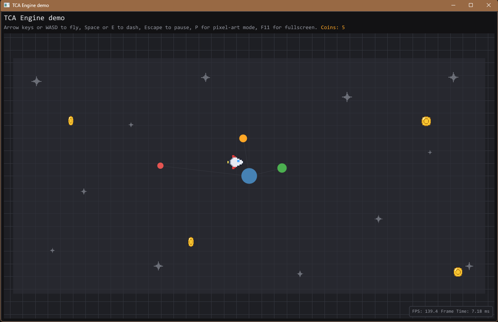

# TCAEngine

[](https://github.com/WinterWind33/tca-engine/actions/workflows/windows.yml)
[](https://github.com/WinterWind33/tca-engine/actions/workflows/linux.yml)
[](https://github.com/WinterWind33/tca-engine/actions/workflows/macos.yml)

TCAEngine is a C++23 engine for 2D and 2.5D games. It is still heavily in progress and grows
feature by feature, as the games built on it need them. It draws through Dear ImGui, on DirectX 12
or OpenGL 3 on Windows. Linux has a GLFW-backed window, and its platform-neutral code builds and is
tested in CI.



## Documentation

The guides live in [`docs/`](docs), one folder per category.

[`examples/demo-app`](examples/demo-app) shows a game-shaped app built on the public API only.
Changes are listed in [`CHANGELOG.md`](CHANGELOG.md).

## Building

Dependencies come from vcpkg through `vcpkg.json`:

```bash
cmake -S . -B build -DCMAKE_BUILD_TYPE=Debug -DTCA_ENGINE_BUILD_TESTS=ON \
  -DCMAKE_TOOLCHAIN_FILE=<path-to-vcpkg>/scripts/buildsystems/vcpkg.cmake
cmake --build build
ctest --test-dir build --output-on-failure
```

Add `-DTCA_ENGINE_BUILD_EXAMPLES=ON` to build the demo too.

## License

[MIT](LICENSE)
