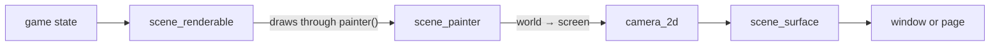
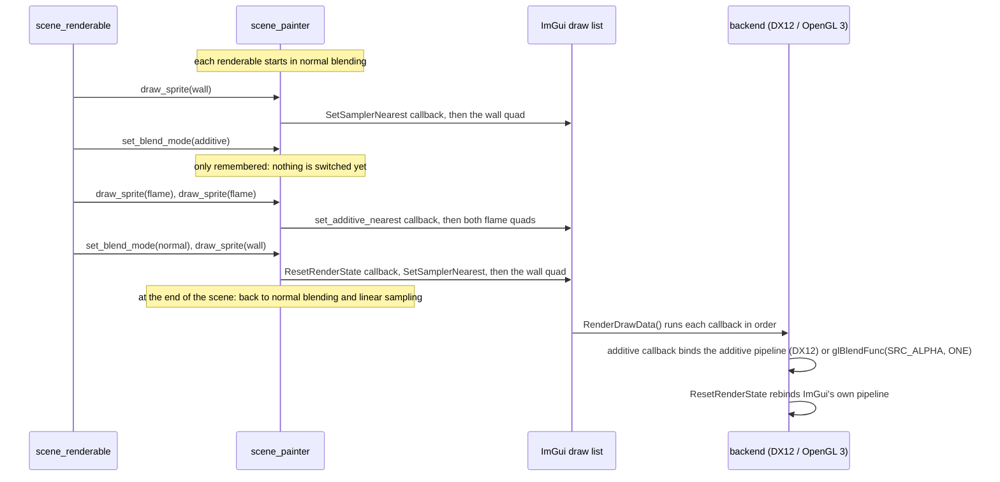
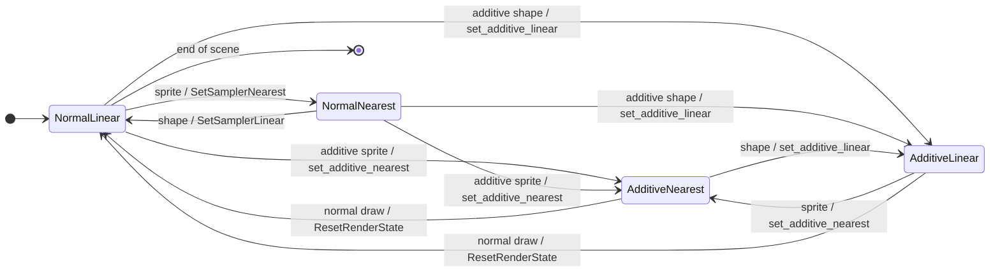

# Scenes

A `scene::scene_surface` is a widget that shows a 2D world through a `camera_2d`. Scene renderables
draw into it with world-space primitives: sprites, filled rectangles, lines and circles.



A surface either takes a rectangle in a page (`scene_surface{"##id", size}`, with zero meaning
"what's left") or covers the whole window (`scene_surface{"##id", scene::fill_window}`).

## Scene renderables

`scene::scene_surface` holds `scene_renderable`s without owning them. Every frame it lays itself
out, syncs its camera, draws its background and grid, and then renders each scene renderable **in
the order it was added**. All of them get the **same** `render_context` per frame, and draw
through its `painter()`, clipped to the surface:

```cpp
class tilemap final : public scene::scene_renderable {
public:
    explicit tilemap(const scene::texture_atlas& atlas) : m_atlas{atlas} {}

    void render(scene::render_context& context) override {
        context.painter().draw_sprite(tile_rect, m_atlas.region("floor"), {.layer = -1});
    }

private:
    const scene::texture_atlas& m_atlas;
};

tilemap floor{atlas};
player_sprite player{game};
surface.add_renderable(floor);   // drawn first
surface.add_renderable(player);  // drawn second
```

Sharing one painter is what keeps `sprite_options::layer` working across objects. The painter holds
back sprites on non-zero layers until every renderable has drawn, so a later renderable's layer -1
sprite still lands under an earlier renderable's shapes. Within one layer, sprites draw in call
order, so an earlier renderable's sprites come first.

Don't add or remove a scene renderable while the surface is drawing (from inside a `render()`).
Resources a scene renderable needs, such as an atlas or the game's state, go in through its
constructor. Why the painter comes in as a parameter is explained in [Tickables](tickables.md).

## Additive blending

Fire, light and glows look flat drawn over each other with normal alpha blending. Switch the
painter to **additive blending** and what it draws is added to what's underneath instead: it only
ever brightens it, and overlapping draws add up.

```cpp
painter.set_blend_mode(scene::blend_mode::additive);
painter.draw_sprite(flame_rect, atlas.region("flame"));
painter.fill_rect(beam_rect, beam_color, 0.4);
painter.set_blend_mode(scene::blend_mode::normal);
```

- **What it covers.** Every sprite and shape drawn after the call, until the next one. A sprite
  held back for its `layer` keeps the mode it was drawn with.
- **Interleaving.** Normal and additive draws mix freely in one frame. The painter only switches
  the renderer when the mode actually changes, so a run of additive sprites costs one switch.
- **Sampling** is unaffected: sprites still use the surface's `sprite_filter()`, shapes stay linear.
- **Scope.** Each renderable starts with `blend_mode::normal`, and the surface switches back to
  normal when it ends, so nothing drawn after it, in the scene or on the page, blends additively.
- **Support.** DirectX 12 and OpenGL 3 blend additively. On a renderer that can't (the null renderer
  of a headless test), additive draws come out with normal blending; `can_blend_additively()` tells
  a game which, if it would rather leave them out.

ImGui has no blend modes, so each backend installs a pair of draw callbacks (one per sampler) that
the painter adds to the draw list, and returns to ImGui's alpha blending with
`DrawCallback_ResetRenderState`. On DirectX 12 these bind a second pipeline state with
`SrcBlend = SRC_ALPHA`, `DestBlend = ONE`, built from the same shaders and root layout as ImGui's.



The painter tracks what the backend is doing (blending normally or additively, sampling linear or
nearest) and adds a callback only when the next draw needs something different:



The demo's coin-pickup bursts are drawn additively.

## Pixel-perfect presentation

A pixel-art game is authored at one small resolution and wants every art pixel to be the same
square of screen pixels. Give the surface a **virtual resolution** and it does the rest:

```cpp
scene::scene_surface surface{"##game", scene::fill_window};
surface.set_virtual_resolution(scene::virtual_size{.width = 320, .height = 180});

// One world unit is one virtual pixel: this camera shows (0, 0)-(320, 180).
surface.camera().set_position(math::vector2{160.0, 90.0});
```

Each frame the surface scales the virtual screen by the **largest whole number** that fits, centres
it, and fills the rest with letterbox bars:

```text
 1366 x 768 window, 320 x 180 virtual resolution -> scale 4 (1280 x 720)

 +------------------------------------------------+
 |                 letterbox (24)                 |
 |   +----------------------------------------+   |
 |43 |              content                   |43 |
 |   |   every virtual pixel = 4 x 4 pixels   |   |
 |   +----------------------------------------+   |
 |                 letterbox (24)                 |
 +------------------------------------------------+
```

- **Snapping.** Sprites (also flipped or turned by quarter turns) and `fill_rect()` snap to whole
  virtual pixels, so nothing lands between art pixels and tiles never show a seam. Sprites turned
  by any other angle aren't snapped. Lines, circles and the grid are scaled but not snapped.
- **Physical pixels.** The scale ignores the UI / display scaling: at 150% a 960x540 window still
  shows 320x180 at exactly 3x.
- **Zoom** still works, in virtual pixels. It's pixel-perfect at whole-number zooms only.
- **Letterbox colour** is a theme role: `set_letterbox_role()`, `window_background` by default.
- **Pointer.** `screen_to_virtual()` maps a screen point to virtual pixels, or `nullopt` over a
  bar; feed the result to `camera().screen_to_world()`. `virtual_to_screen()` goes the other way.
- **Off.** `set_virtual_resolution(std::nullopt)` gives back the plain surface.

`presentation_layout()` returns the last frame's scale, content rectangle and bars. The maths is
also available on its own, with no ImGui, as `compute_pixel_perfect_layout()` in
`rendering/scene/virtual-resolution.hpp`.

The demo (`examples/demo-app`) shows it: press **P** for a 320x180 checkerboard and a drifting
coin, and **F11** to try every scale your screen allows.
